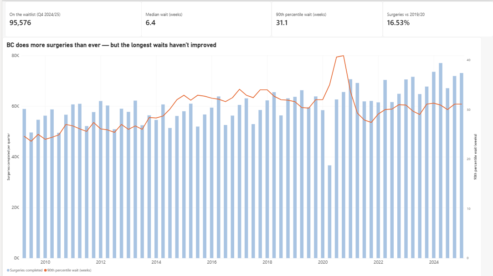
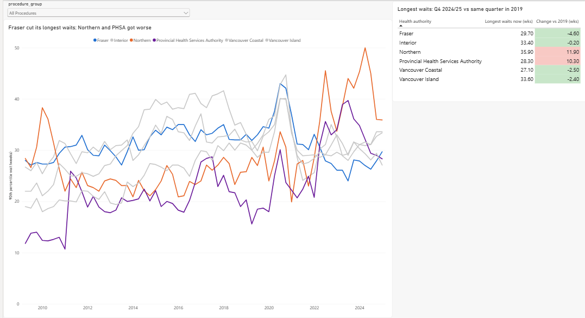
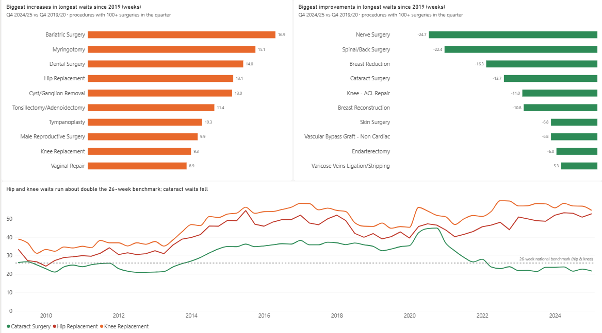

# BC Surgical Wait Times, 2009–2025

**BC now does more scheduled surgeries than ever, up 16.5% on 2019/20, but the longest waits have not improved.** The 90th-percentile wait is still about 31 weeks, and results differ a lot by region. Fraser Health cut its longest waits by 4.6 weeks, while Northern Health's grew by 11.9 weeks.

This project cleans and validates 15 years of BC Ministry of Health surgical wait-time data in Python and presents the results in a Power BI dashboard.



## Key findings

All comparisons use the same quarter in 2019/20 (pre-COVID) and 2024/25, because percentiles cannot be averaged across quarters.

| Measure (province, all procedures) | 2019/20 | 2024/25 | Change |
| --- | --- | --- | --- |
| Surgeries completed (fiscal year) | 248,203 | 289,228 | +16.5% |
| People on the waitlist (Q4) | 93,388 | 95,576 | +2.3% |
| Median wait, weeks (Q4) | 7.1 | 6.4 | −0.7 |
| 90th-percentile wait, weeks (Q4) | 32.0 | 31.1 | −0.9 |

- **The longest waits are worse than a decade ago.** The 90th-percentile wait averaged about 26 weeks (range 24–27) from 2009/10 to 2012/13 and is about 31 weeks now.
- **Regions diverge.** In Q4 2024/25 vs Q4 2019/20, the 90th-percentile wait changed by −4.6 weeks in Fraser, −2.5 in Vancouver Coastal, −2.4 in Vancouver Island, −0.2 in Interior, +10.3 in the Provincial Health Services Authority and +11.9 in Northern.
- **Hip and knee waits run about double the national benchmark.** In Q4 2024/25 the 90th-percentile wait was 52.7 weeks for hip replacement and 54.7 for knee replacement, against the 26-week pan-Canadian benchmark. In 2009/10–2012/13 they averaged about 30 and 36 weeks.
- **Procedures moved in opposite directions.** Compared with Q4 2019/20, the 90th-percentile wait rose by 13.1 weeks for hip replacement and 9.3 for knee replacement. It fell by 22.4 weeks for spinal/back surgery and 13.7 for cataract surgery (procedures with 100+ surgeries in the quarter).
- **Hospitals in the same region differ a lot.** In Fraser Health in Q4 2024/25, the 90th-percentile wait ranged from 12 weeks (Delta Hospital) to 45 weeks (Burnaby Hospital).





## Data

- **Source:** [BC Surgical Wait Times](https://catalogue.data.gov.bc.ca/dataset/bc-surgical-wait-times), BC Ministry of Health, BC Data Catalogue. The file used is the quarterly historical file (fiscal 2009/10 Q1 to 2024/25 Q4).
- **Size:** 202,953 rows, covering 6 health authorities, 66 hospitals and 85 procedure groups.
- **Measures:** patients waiting at quarter end, surgeries completed, and median and 90th-percentile wait in weeks, from the date the health authority receives the booking form to the date of surgery.
- **Fiscal quarters:** Q1 = Apr–Jun, Q2 = Jul–Sep, Q3 = Oct–Dec, Q4 = Jan–Mar.

## Method

1. **Cleaning** (`scripts/clean_wait_times.py`)
   - Counts below 5 are suppressed in the source as `<5` to protect patient privacy. They are converted to blanks with a `*_suppressed` flag, never to zero.
   - Fiscal year and quarter are converted to a real quarter-start date.
   - Each row is labelled with its level (province, health authority or hospital) and an "All Procedures" flag. The source mixes pre-calculated totals with detail rows, so summing everything would double count.
2. **Validation checks** (run automatically by the script)
   - There are no duplicate rows on fiscal year, quarter, authority, hospital and procedure.
   - The median is never greater than the 90th percentile.
   - Hospital totals reconcile with health-authority totals. The median gap is 0 and the maximum gap is 8 surgeries, which matches the suppressed cells.
3. **Analysis** (`scripts/analyze.py`) compares each quarter with the same quarter in 2019/20.
4. **Dashboard** (`bc_surgical_wait_times.pbix`) is built in Power BI. Wait-time measures use `SELECTEDVALUE`, so a visual shows a blank rather than a wrong number if several percentiles would otherwise be combined.

## Limitations

- **Percentiles cannot be added or averaged.** Every figure here is read from the level the Ministry published.
- **Suppression:** small counts (<5) are hidden, so hospital totals can differ slightly from health-authority totals.
- **PHSA series:** there is a sudden jump in 2011 (about 11 to 25 weeks), likely a change in reporting scope rather than a real change in waits.
- **Scope:** the data covers scheduled surgery only. It measures the wait from booking to surgery, not the wait to first see a surgeon.

## Reproduce

```bash
pip install -r requirements.txt
python scripts/clean_wait_times.py data/raw/2023_2024-quarterly-surgical_wait_times-final.xlsx data/processed
python scripts/analyze.py data/processed/wait_times_clean.csv
```

Download the raw file from the source link above into `data/raw/`. The three tables the dashboard uses are already in `data/`.

## Next steps

- Compare BC with other provinces using [CIHI wait-time data](https://www.cihi.ca/en/explore-wait-times-for-priority-procedures-across-canada) against national benchmarks (e.g., 26 weeks for hip and knee replacement).
- Add the 2025/26 interim quarters when they are published.

## Tools

Python (Pandas) · Power BI (DAX, Power Query) · Git/GitHub

---
Karim Abushbak · [LinkedIn](https://linkedin.com/in/karim-abushbak-6269a1362)
